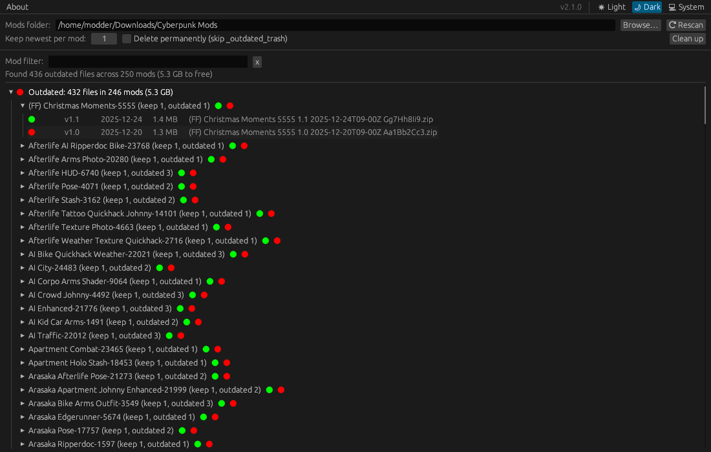
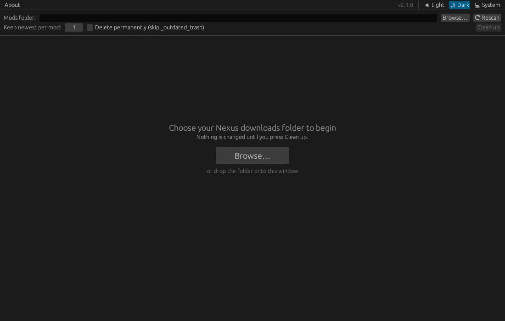
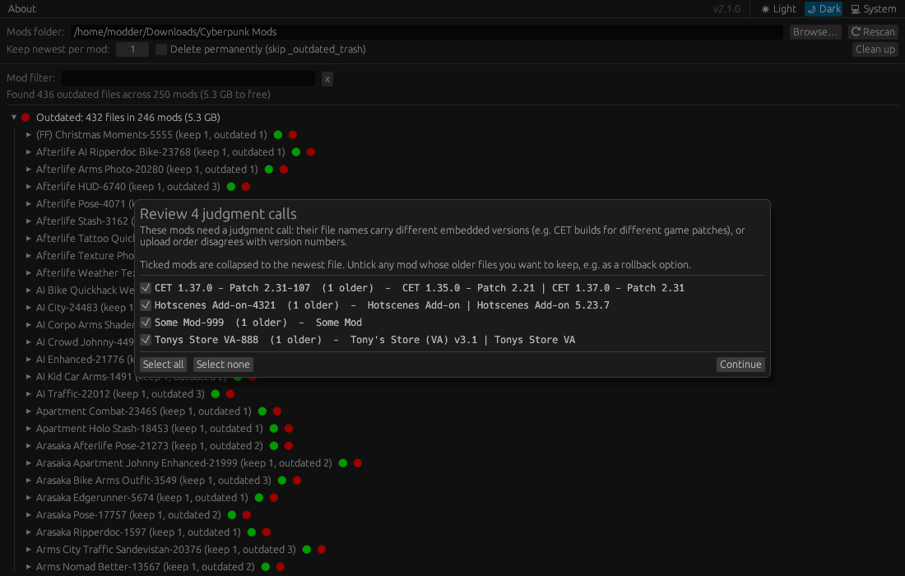
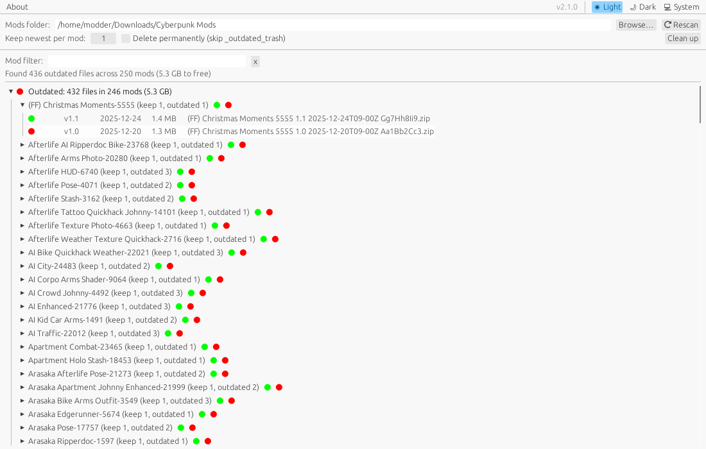
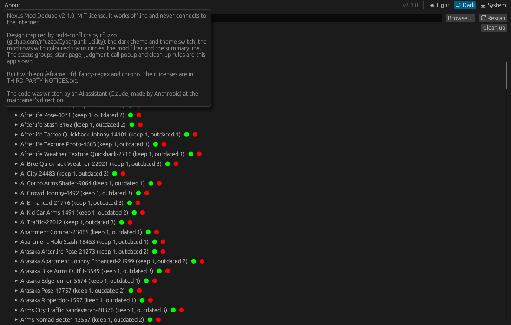

# Nexus-Mod-Duplication-Cleanup

A small native app that finds outdated versions of mods in your Nexus Mods download folder and removes them, keeping only the newest file of each mod. Mods that need a judgment call, such as builds for different game patches, stay untouched until you say what to remove. Works on Windows and Linux.



## Download

Grab the latest build from the [Releases](../../releases) page:

- **Windows:** `NexusModCleanup-windows.exe`
- **Linux:** `NexusModCleanup-linux` (run `chmod +x NexusModCleanup-linux` once)
- **Windows, as an archive:** `NexusModCleanup-v<version>-windows.7z` holds the same exe with this README, the license and `THIRD-PARTY-NOTICES.txt`. This is the file uploaded to Nexus Mods.

Each is a single program with nothing to install and nothing unpacked to a temp folder. On Linux it needs a desktop session (X11 or Wayland) with OpenGL, which every mainstream desktop has.

## What it does and doesn't do

- It only looks at the folder you pick. It never touches game files or anything outside that folder.
- Nothing changes until you press **Clean up** and confirm. Outdated files are moved to `_outdated_trash` unless you tick **Delete permanently**.
- It never connects to the internet: no update checks, no telemetry, no links. Every build is checked for networking libraries, and the Windows build for networking DLL imports.
- It writes two things besides moving files: a `dedupe_log_<date>.txt` in the mods folder after each clean-up, and a small settings file (last folder, keep count and theme) in your user profile, under `%APPDATA%` on Windows or `~/.local/share` on Linux.

## Using the app

1. Pick your mod downloads folder with **Browse…**, or drop the folder onto the window (or onto the exe). The app scans it straight away and opens on your mods. Next time it opens straight on the same folder. Scanning never changes anything on disk.
2. Your mods are sorted into groups, each marked with a coloured circle:
   - 🔴 **Outdated**: mods with older files that **Clean up** would remove.
   - 🟢 **Up to date**: mods with nothing to remove.
   - ⚪ **Needs review**: judgment calls, each with a tick box (see below).
   - ⚪ **Not recognised**: files that don't follow a Nexus naming pattern. These are never touched.

   Expand a mod to see its files, newest first: green files are kept, red files are outdated and grey files are left alone. Hover over a circle to see what will happen to that file. Type in **Mod filter** to find a mod by name or ID.
3. If any mods need a judgment call, a popup lists them. Ticked mods are collapsed to the newest file. Untick any mod whose older files you want to keep, for example to roll back after a game patch. You can change these ticks later under **Needs review**.
4. Press **Clean up**. By default outdated files go to an `_outdated_trash` subfolder, so you can check them before deleting that folder yourself. Tick **Delete permanently** to skip the trash.

If the folder has no Nexus downloads, the app keeps showing its start page and says so. **Clean up** stays disabled until there is something to remove.

**Keep newest per mod** keeps more than one file per mod, e.g. `2` keeps the previous version of everything as a rollback copy.

The window is dark by default. The **Light / Dark / System** switch at the top right changes this, and the app remembers your choice. **About**, at the top left, shows the version and the [credits](#credits-and-origins).

A `dedupe_log_<date>.txt` file recording every decision is saved in the folder after each cleanup.

## Screenshots

These use a made-up sample folder.

| | |
|---|---|
|  |  |
| The start page, before a folder is chosen | The judgment-call popup |
|  |  |
| The light theme | The About menu, with the credits |

## How it decides

Both Nexus filename formats are recognised:

```
old: Autoloot-5202-3-10-2-1779529077.zip
new: Autoloot 5202 3.11.2 2026-10-17T10-20Z ozVyzbbhu.zip
```

- Files belong to the same mod when the **mod ID** matches and the names match after ignoring case, punctuation and versions written into the name. `Hotscenes Add-on 5.23.7` and `Hotscenes Add-on` are one mod; `(FF) Christmas Moments` and `(MF) Christmas Moments` stay separate variants.
- The newest **upload date** from the filename wins, not the file's modified date on disk, which changes when files are copied or restored. Version numbers break ties.
- **Judgment calls** are mods whose file names carry different versions (e.g. `CET 1.35.0 - Patch 2.21` vs `CET 1.37.0 - Patch 2.31`), or whose upload order disagrees with their version numbers. These are always shown in the popup before anything is removed.
- Files that don't follow a Nexus naming pattern (`setup.exe`, `Autoloot.zip`, …) are never touched.

## Command line

`nexus_dedupe.py` is the same engine without the window, for Python 3.8+ with no extra packages. The app is a line-for-line port of it, and every build checks that both make identical decisions:

```
python nexus_dedupe.py --folder "path/to/mod downloads"               # dry run, writes a log
python nexus_dedupe.py --folder ... --execute                         # move outdated files to _outdated_trash
python nexus_dedupe.py --folder ... --execute --hard                  # delete permanently
python nexus_dedupe.py --folder ... --keep 2                          # keep a rollback copy of each mod
```

With `--execute`, it asks about each judgment call and then confirms once before acting. `--yes` skips all prompts and collapses everything.

## Verifying downloads

Every release binary is built by GitHub Actions straight from this repository, with a `.sha256` checksum and a signed build-provenance attestation alongside it:

```
sha256sum -c NexusModCleanup-linux.sha256                       # Linux
Get-FileHash NexusModCleanup-windows.exe                        # Windows PowerShell; compare with the .sha256 file
gh attestation verify NexusModCleanup-windows.exe -R Adaptive-Protocol/Nexus-Mod-Duplication-Cleanup
```

## Code signing policy

Free code signing provided by [SignPath.io](https://about.signpath.io), certificate by [SignPath Foundation](https://signpath.org).

- Committers and reviewers: [Adaptive-Protocol](https://github.com/Adaptive-Protocol)
- Approvers: [Adaptive-Protocol](https://github.com/Adaptive-Protocol)

Only the Windows binary is signed. It is built by this repository's GitHub Actions workflow and each release is approved manually before signing.

**Privacy policy:** This program will not transfer any information to other networked systems unless specifically requested by the user or the person installing or operating it.

## Building

The app is written in Rust with [egui](https://github.com/emilk/egui). With [Rust](https://rustup.rs) installed:

```
cargo build --release          # binary in target/release/
cargo test                     # engine tests
tests/parity.sh                # compare decisions with nexus_dedupe.py (Linux/macOS)
```

Pushing a `v*` tag that matches the version in `Cargo.toml` builds both binaries on GitHub Actions and attaches them to a GitHub release, together with checksums and `THIRD-PARTY-NOTICES.txt` (see `.github/workflows/build.yml`).

## Credits and origins

Where the app's design and code come from:

- **Design:** the look is inspired by [red4-conflicts](https://github.com/rfuzzo/Cyberpunk-utility) by [rfuzzo](https://github.com/rfuzzo), a conflict checker for Cyberpunk 2077 archive mods. From it come the dark theme and its Light / Dark / System switch, the collapsible mod rows with coloured status circles after each name and counts in brackets, the mod filter and the summary line. No code was copied. The status groups, the start page, the judgment-call popup and the clean-up rules are this app's own.
- **Engine:** the rules for grouping and ranking files were written for this project, first as `nexus_dedupe.py` and then ported line for line to Rust. The filename formats it reads are the ones Nexus Mods gives its downloads.
- **Libraries:** [egui/eframe](https://github.com/emilk/egui) draws the window, [rfd](https://github.com/PolyMeilex/rfd) opens the native folder picker, [fancy-regex](https://github.com/fancy-regex/fancy-regex) matches file names and [chrono](https://github.com/chronotope/chrono) reads dates. They and their dependencies all use permissive licenses (MIT, Apache-2.0, BSD, Zlib and similar). Each release includes `THIRD-PARTY-NOTICES.txt` with their full license texts.
- **AI:** the code, tests and documentation were written by an AI assistant (Claude, made by Anthropic) at the maintainer's direction. On Nexus Mods the app is tagged AI-Generated Content.

The **About** menu in the app shows the same credits.

## License

MIT, see [LICENSE](LICENSE).
